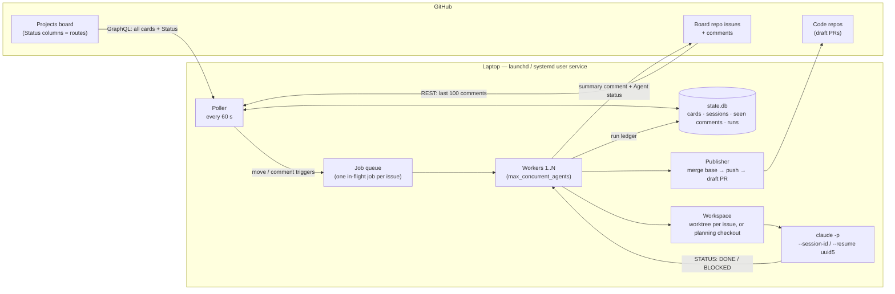
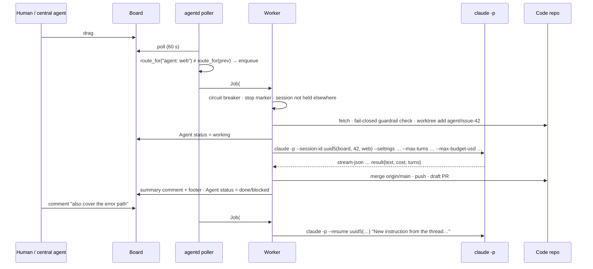

# pado

**pado** runs a fleet of Claude Code agents on your laptop from a GitHub Projects board.
Its daemon, **agentd**, reads the board. You give an agent work by dragging a card into its
column, and you talk to that agent by commenting on the issue. Each agent works in its own git
worktree, keeps one resumable conversation per issue, and returns its work as a draft pull
request.

*Pado* (پادو) is Persian for the person who runs the errands. Here, the errand-runner is an
agent, and the board is the list of errands.

```
drag card → agent: web          agent works in ~/agents/web/issue-42 on branch agent/issue-42
comment "also add tests"   →    same conversation resumes with your comment as the next turn
agent finishes             →    branch pushed, draft PR opened, summary posted on the issue
laptop closed for a week   →    nothing runs, nothing is lost; next poll sees the board as it is
```

> **Status:** reference implementation, not a maintained product. pado ran as one person's
> production setup from 14 August to 12 October 2026, with 12 routes covering both client and
> personal work. Then it was stopped in favour of a different setup. The code is the code that
> ran. The numbers in [Metrics](#metrics-from-production) come from its run ledger. Expect to
> adapt it, not install it unchanged.

---

## Contents

- [Why it exists](#why-it-exists)
- [Architecture](#architecture)
- [How orchestration works](#how-orchestration-works)
- [Safety and permission layers](#safety-and-permission-layers)
- [Memory model](#memory-model)
- [Metrics from production](#metrics-from-production)
- [Install](#install)
- [Repository layout](#repository-layout)
- [What it deliberately does not do](#what-it-deliberately-does-not-do)

---

## Why it exists

The requirements were:

1. Agents run **on the laptop**, using local checkouts, local credentials, and a logged-in
   browser. They do not run in CI.
2. **Laptop off means nothing runs**, and no event is lost.
3. **The board is the only interface.** One issue is one conversation, and you reach it by
   commenting.
4. **Columns route to different agents.** All issues live in one board repo. The work happens
   in many code repos, each with its own agent, rules, and permissions.
5. A **central planning agent** can triage incoming work and hand it to project agents. It
   does this with the same board gestures a human uses.

The rest of the design follows from requirement 2. Webhooks need a public endpoint, and GitHub
drops a delivery for good after a few retries while the laptop sleeps. **Polling reads current
state**, so being offline costs nothing. Because there is no event backlog to replay, the daemon
is crash-safe without extra work. The cost is up to one poll interval (60 s) of latency, which
nobody dragging a card will notice. The full rationale and the rejected alternatives are in
[`docs/DESIGN.md`](docs/DESIGN.md).

---

## Architecture

agentd is one Python file ([`src/agentd.py`](src/agentd.py), about 1,950 lines, standard
library only). It shells out to `gh`, `git`, and `claude`, and keeps its state in one SQLite
file.



| Component | What it does | Where |
|---|---|---|
| **Config** | TOML file with global tunables and one `[[route]]` per agent. It is validated at load: no column may belong to two routes, and every worktree route needs a repo. | `Config`, `Route` |
| **Board** | Reads every page of the Projects v2 board through GraphQL. It writes only the optional `Agent status` and `Scope` fields, plus `Status` when a card is parked. | `Board` |
| **State** | SQLite holding the last-seen column per card, sessions per (issue, route) with the `running` lease, seen comment IDs, attended sessions, and the run ledger. | `State` |
| **Supervisor** | Runs the poll loop, the job queue, the worker threads, reconciliation at boot, and the attended-session watcher. | `Supervisor` |
| **Runner** | Builds the `claude -p` command, streams the JSON output to a per-issue log, and parses the final result event. | `run_agent`, `_claude_once` |
| **Publisher** | Merges the base branch into the issue branch, pushes, and opens or updates a draft PR. It never force-pushes and never merges the PR. | `publish` |
| **Weekly report** | Builds a Monday digest from closed issues, the run ledger, and the live board. | `scripts/weekly-report.py` |

---

## How orchestration works

### 1. Columns are the routing table

Each `[[route]]` binds one or more `Status` options to one agent identity: a working directory,
a mode, and a session namespace.

```toml
repo           = "you/board"        # where every issue lives
project_owner  = "you"
project_number = 1

[[route]]                            # the central planning agent
name            = "central"
columns         = ["In plan"]
workdir         = "~/workspace/planning"
mode            = "in_place"
trigger_on_move = false              # cards are reshuffled here all day

[[route]]                            # one project agent
name    = "web"
columns = ["agent: web"]
workdir = "~/workspace/web-app"
repo    = "you/web-app"
mode    = "worktree"
browser = true                       # headless runs get the Chrome bridge
```

The column a card sits in **is** the record of which agent owns it. The daemon never moves a
card to mark it as "working". If it did, the card would leave its owner's column, and follow-up
comments would have no route. Three separate dimensions are modelled in three separate places:

| Dimension | Stored in | Written by |
|---|---|---|
| **Ownership**: whose queue is this card in? | `Status` column | the human or the central agent |
| **Run state**: is the agent working, done, or blocked? | optional `Agent status` field | the daemon only |
| **Completion**: is the task finished? | issue open or closed | the human (or an explicit "close it" in the thread) |

Columns that no route claims, such as backlog or parking columns, are invisible to the daemon.

### 2. Two triggers, diffed against `state.db`

Each poll fetches the whole board and the last 100 comments in the board repo, then compares
them with what it recorded last time:

- **Move trigger.** A card enters a column whose route differs from the route of its previous
  column. This is the handover gesture. A move between two columns of the same route never
  fires, and routes with `trigger_on_move = false` ignore moves completely.
- **Comment trigger.** A new comment arrives on a card in a routed column. The first comment
  starts the session, and every later comment is a follow-up turn. The daemon reacts 👀 on the
  comment so you can see it was picked up.

Several rules keep these triggers correct:

- **Priming at first boot.** With an empty `state.db`, the daemon records every card's column,
  marks all existing comments as seen, and launches nothing. Without this, every card already
  in a routed column would fire at once.
- **Deferral, never loss.** A comment that arrives while that issue's agent is running is not
  marked seen, so the first poll after the run ends picks it up. In the same way, a move during
  a run leaves the stored column out of date, so the move fires again later.
- **The daemon's own comments are not commands.** Every comment the daemon or an agent posts
  starts with `<!-- agentd -->`, and comments carrying that marker are skipped. If the daemon
  posts through a separate bot account (`bot_login`), comments from that login are skipped too,
  and GitHub then sends the human notifications for agent replies.
- **Old comments are not replayed.** Comments on cards outside any route are marked seen at
  once, so routing a card later doesn't replay its old discussion. The prompt tells the agent
  to read the whole thread instead.

### 3. Queue, workers, and locks



- **Bounded pool.** `max_concurrent_agents` worker threads take jobs from one queue. In
  production this started at 2 and was raised to 4 after bursts of card moves built up a
  backlog.
- **One in-flight job per issue.** An in-memory set rejects a second job for an issue that is
  queued or running, so two processes never write to one conversation.
- **Per-repo setup lock.** Concurrent jobs on the same repo share one `.git`, and parallel
  `fetch` or `worktree add` commands collide on git's lock files. The daemon serializes only
  worktree creation. The agent runs themselves stay parallel.
- **One browser at a time.** There is one Chrome. Routes with `browser = true` take a global
  lock, so two agents never interleave tab operations.
- **Session ownership check.** Before a launch, the daemon searches the process table for the
  session UUID. If a human has that session open in a terminal, the run is refused with a
  comment instead of corrupting the transcript.

### 4. Deterministic sessions

```python
session_id = uuid.uuid5(NAMESPACE, f"agentd://{board_repo}/issue/{n}/route/{route}")
```

Issue #42 on route `web` always maps to the same UUID. The first run passes `--session-id`, and
every later run passes `--resume` with the same value. No session ID is stored, so the mapping
can't drift: it is recomputed each time. If `state.db` and `~/.claude` disagree about whether a
session exists, the run produces no output. The runner then retries once with the flag flipped,
which fixes both cases.

The route is part of the key because Claude Code stores sessions per working directory. If you
move a card from one agent's column to another's, the new agent starts a fresh conversation in
its own repo. That is correct, because it has different context.

### 5. Two workspace modes

- **`worktree`** (project routes): the daemon cuts `~/agents/<route>/issue-N` on branch
  `agent/issue-N` from `origin/<base>`. Each issue gets a real directory with its own `HEAD` and
  index, and all worktrees share one object store, so parallel agents on one repo are safe.
  Worktrees prevent git collisions, but not semantic ones: two agents editing the same module
  still produce two PRs that can't both merge. Scheduling around that is the human's job.
- **`in_place`** (the central route): the agent runs in the planning checkout itself. It
  commits but does not push and opens no PR. Its output is triage, planning-file edits, message
  drafts, and board moves.

Before every run, the daemon also refreshes the agent's rules. Without this, a worktree created
weeks ago would follow the rules from the day it was created:

| Step | Effect |
|---|---|
| **Fail-closed guardrail check** | A new worktree route refuses to launch when `CLAUDE.md`, `.claude/settings.json`, or `docs/agent-journal/README.md` is missing on `origin/<base>`. The card is parked as blocked with a comment that names the missing files. |
| **Guardrail sync** | Those files and `.gitattributes` are checked out from `origin/<base>` into the worktree at every run start, so permissions can't drift. |
| **Fleet rules** | One file holds the rules for every route: `~/.agentd/FLEET-RULES.md`, which bootstrap installs from `templates/`. It is copied into each worktree as `.claude/FLEET-RULES.md`. |
| **`INSTRUCT.md`** | An optional, gitignored file in a route's main checkout, holding instructions for the agent only. It is appended to the system prompt of every run without being committed to a repo that other people share. |

### 6. The run

```
claude -p <prompt> [--chrome] --output-format stream-json --verbose
       --permission-mode acceptEdits --max-turns 120 --max-budget-usd 10
       --model <route/card/comment model> [--effort <level>]
       --session-id|--resume <uuid5> --settings <worktree>/.claude/settings.json
       [--append-system-prompt <INSTRUCT.md>]
```

- **The prompt protocol.** The first prompt gives the agent its worktree, branch, and the
  issue. It tells the agent to read `CLAUDE.md` and the journal, then the whole issue thread.
  The agent must end with a 3–6 line summary and the literal token `STATUS: DONE` or
  `STATUS: BLOCKED`. Follow-up prompts carry only the new comment. Other prompt templates cover
  interrupted runs (*reconcile*) and closing an attended session (*settle*).
- **Per-card model and effort.** A line such as `pado: model=opus effort=high` sets the
  default in the issue body, and the same line in a comment overrides it for that one run.
  Invalid values are logged and ignored.
- **Settings are passed explicitly.** A headless run ignores the `.claude/settings.json` of an
  untrusted directory, and every new worktree is untrusted. The daemon therefore passes
  `--settings` itself.
- **Caps.** If a run ends by hitting the turn or budget cap, the daemon posts a readable
  explanation in place of an empty failure. The session survives, so the next comment
  continues with a new budget.

### 7. Publishing and reporting back

For worktree routes, after a successful run, the daemon:

1. Merges `origin/<base>` into the issue branch. Conflicts limited to guardrail files resolve
   to the base's version, and real conflicts are reported. Without this step, every change to
   the fleet rules made every open agent PR unmergeable.
2. Pushes the branch without force, because an attended session may also have pushed to it.
3. Opens a **draft** PR, or reuses the existing one. Merging is a human act.

Then, for every route, the daemon posts the agent's summary on the issue with a footer line:

```
web · comment · claude-sonnet-5 · 31 turns · 412s · $2.14 · session 3f9a1c0e
```

It also sets `Agent status` and, if configured, raises a macOS notification (picked up, done,
blocked, failed, or interrupted).

### 8. Hierarchical orchestration: the central agent

pado routes cards with plain board gestures, and the central agent can make the same gestures
a human makes. A card in the planning column runs the central agent in the planning repo. Its
`CLAUDE.md` holds triage rules, which tell it to do one of three things:

- **Small task.** Do it on the spot, or draft a reply into the planning repo for the human to
  send.
- **A decision, or work too hard for an agent.** Create a card for the human.
- **Delegable work.** Commit the context into the **project's own repo**, because a project
  agent can't read the planning repo. Then create a card that links to that context and move it
  into `agent: <track>`. On the next poll, the move hands the work over.

Comments use the same mechanism. A marked comment is inert. An **unmarked** comment on a routed
card wakes that card's agent, so the central agent can instruct another agent on purpose, while
routine notes it posts can't trigger anything by accident. The result is a two-level tree:

```
                 you
                  │  drag / comment
        ┌─────────▼─────────┐
        │  central (pado)   │  triage · drafts · plans · card moves
        └──┬──────┬──────┬──┘
           │      │      │   move card into agent: <track> (+ context committed in that repo)
        ┌──▼─┐ ┌──▼─┐ ┌──▼──┐
        │web │ │docs│ │infra│ …   one worktree + session + draft PR per issue
        └────┘ └────┘ └─────┘
```

### 9. The attended lane

Some work can't finish headless: it needs 2FA, a judgment call, or a message sent into Slack or
email. In that case the agent ends with `STATUS: BLOCKED`, and the comment suggests:

```sh
agentd.py attend 42          # resume the same session interactively, with the browser
```

This runs `claude --resume <uuid5>` in the same worktree. While the terminal is open, the
watcher sees the session UUID in the process table, and headless runs for that issue are
refused. When you close the terminal, the daemon starts a short **settle run** in the same
conversation. That run commits any finished work and posts what the attended session achieved,
so closing the terminal is all you need to do.

### 10. Failure handling

| Situation | Response |
|---|---|
| Laptop sleeps or shuts down mid-run | The `running` lease (set before launch, cleared in `finally`) is still set at boot. `reconcile()` then posts a note (the default) or re-enqueues with a *reconcile* prompt. The worktree and session survive either way. |
| Runaway issue | A circuit breaker refuses a run once an (issue, route) pair reaches `max_runs_per_issue` (20). |
| Worker exception | The card is marked `blocked`, a notification is raised, and a comment points to the daemon log. |
| Push or PR creation fails | The work stays committed in the worktree. The run is reported as blocked, not as a crash. |
| You want it to stop | `agentd.py --stop 42` stops it. The daemon drops a stop marker that cancels a queued job before launch, and kills a running one. The marker expires after 15 minutes, so it can't swallow a later, unrelated comment. |
| Network down | The poll fails, is logged, and is retried at the next interval. |

---

## Safety and permission layers

What an agent may do is decided by five layers, and only the first three are in a config file:

| Layer | Configured in | Notes |
|---|---|---|
| git, shell, and `gh` | each repo's `.claude/settings.json` allow and deny lists | `git push` is denied on every route. Only the daemon pushes. |
| internet | `WebFetch` and `WebSearch` in the same allow list | Granted per route. |
| browser | `browser = true` on the route **and** `mcp__claude-in-chrome` in the allow list | Both are needed. Browser runs execute one at a time. |
| `--permission-mode acceptEdits` | the daemon's command line | Overrides the user's global default mode. Writes inside the worktree are auto-accepted, and paths outside it, such as `/tmp`, are not. |
| Claude Code's auto-mode classifier | nowhere; it is built in | Observed in production: an **unattended agent can read a human channel but not post into it**. Navigating to Slack and reading were allowed. Typing and sending the message were blocked. Work whose deliverable is a sent message therefore goes to the attended lane or to a human. |

[`docs/RULES-MATRIX.md`](docs/RULES-MATRIX.md) lists the nine places where an agent rule can
live and how to change each one. The daemon never holds or passes secrets, with one exception:
the optional bot token, which it removes from the agent's environment.

---

## Memory model

The session is not the memory. These are separate layers:

| Layer | Holds | Lifetime |
|---|---|---|
| repo `CLAUDE.md` | architecture, commands, conventions, and triage rules in the planning repo | stable |
| `.claude/settings.json` | permissions | stable, re-synced every run |
| `.claude/FLEET-RULES.md` | rules shared by every route | re-synced every run |
| `docs/agent-journal/<issue>-<slug>.md` | lessons a future agent would otherwise learn again the hard way | grows; one file per entry, so concurrent PRs don't conflict |
| session (uuid5) | this issue's working conversation | one issue's lifetime |
| git history | the result | permanent |

Retire a session after its PR merges. Each resume re-reads the whole transcript as cached input,
so a session resumed 15 times costs more per turn than a fresh one with a good journal.

---

## Metrics from production

The daemon writes one row per headless run to the `runs` table in `state.db` when the run ends.
The row holds the route, trigger, wall time, turns, cost, outcome, model, and effort. Everything
below comes from that ledger and from the GitHub API.
[`scripts/metrics.sql`](scripts/metrics.sql) reproduces the ledger figures from any `state.db`.

**Period.** The daemon was live from **14 August 2026** to **12 October 2026**, when it was
stopped. Almost all agent work fell in the first two and a half weeks: 286 of 287 runs happened
between 14 and 30 August. After that, the board stayed polled but quiet, and the work moved to
other tools.

### Headline

| | |
|---|---|
| Headless agent runs | **287** |
| Distinct issues worked | **108**, in **116** sessions (issue × route) |
| Routes configured / used | 13 / 12 (1 central + 11 project routes) |
| Agent wall time | **24.2 h**: median run 3 min 14 s, p90 12 min 56 s, longest 37 min |
| Agent turns | 7,117 in total, 24.8 per run on average |
| Token cost (API-equivalent) | **$610.59**: median $1.48 per run, p90 $4.98, max $10.05 (the $10 per-run cap) |
| Draft PRs opened from `agent/issue-*` branches | **95** in 10 repos: **61 merged** (64%), 23 closed unmerged, 11 still open |
| Issues the bot account commented on | 58. The bot account was introduced 5 days in; earlier comments were posted under the owner's account. |

**Cost caveat.** The dollar figure is the Claude CLI's own `total_cost_usd`: actual tokens
(input, output, cache writes, and cache reads) priced at API list rates. This fleet ran on a
Claude Team seat, not an API key. The figure therefore measures consumption against the plan,
not money billed per run. It is still the right figure for comparing effort across issues.

### Outcomes

| Outcome | Runs | Share |
|---|---:|---:|
| `STATUS: DONE`: ready for review | 242 | 84.3% |
| `STATUS: BLOCKED`: the agent needed a human | 32 | 11.1% |
| Failed (crash, cap hit, or no result) | 13 | 4.5% |

"Blocked" is the system working as designed: the agent stopped and asked for help instead of
guessing. The run comment then pointed to the attended lane (`agentd.py attend <issue>`).

### What started the runs

| Trigger | Runs | Cost |
|---|---:|---:|
| Comment on a routed card (start or follow-up) | 105 | $303.85 |
| Card moved into an agent column | 36 | $98.30 |
| Card moved back into a column with an existing session | 1 | $1.58 |
| Rebuilt from run transcripts for 14–19 August, before the ledger existed (trigger not recorded) | 145 | $206.87 |

Among runs with a recorded trigger, **74% came from comments**. The board worked mostly as a
conversation surface, and handover moves were the minority.

### Sessions

58 sessions did their work in one run. The other 58 were resumed at least once: 26 ran twice,
and the longest session ran 16 times. Deterministic session IDs made this cheap. Nothing was
stored, and every comment simply resumed the conversation.

### By week

| Week of | Runs | Issues | Agent hours | Cost |
|---|---:|---:|---:|---:|
| 10 Aug (live from Thu 14) | 70 | 33 | 4.2 | $95.85 |
| 17 Aug | 172 | 54 | 13.8 | $363.34 |
| 24 Aug | 44 | 24 | 6.2 | $150.06 |
| 31 Aug | 0 | 0 | 0 | $0 |
| 7 Sep | 1 | 1 | 0.1 | $1.34 |

### By route

Route names are anonymized because the project routes belonged to private and client
repositories.

| Route | Runs | Issues | Agent hours | Cost | Avg per run | Blocked | Failed |
|---|---:|---:|---:|---:|---:|---:|---:|
| central (planning) | 108 | 48 | 8.7 | $219.80 | $2.04 | 9 | 6 |
| project A | 60 | 14 | 3.9 | $162.15 | $2.70 | 5 | 2 |
| project B | 35 | 13 | 3.4 | $70.36 | $2.01 | 4 | 2 |
| project C | 19 | 8 | 3.1 | $64.54 | $3.40 | 8 | 0 |
| project D | 15 | 6 | 0.8 | $14.61 | $0.97 | 3 | 0 |
| project E | 14 | 6 | 0.7 | $16.55 | $1.18 | 0 | 0 |
| project F | 13 | 10 | 2.0 | $33.57 | $2.58 | 2 | 2 |
| 5 smaller routes | 23 | 11 | 1.6 | $29.02 | $1.26 | 1 | 1 |

The central planning agent did **38% of all runs**. Triage, drafting, and handing work off were
the largest single workload, ahead of any one codebase. Project C had the highest blocked rate: 8 of its 19 runs ended by
asking for a human.

### Models and timing

- The default model was Sonnet. Per-card `pado: model=… effort=…` directives were used on about
  20 runs, mostly to escalate to Opus at `max` effort for hard tasks. Runs also report Haiku,
  which Claude Code uses for its own sub-tasks.
- By hour, runs peaked from 10:00 to 14:00 local time. 46 runs (16%) started between 23:00
  and 04:00.

### What the ledger does not count

- **Attended (interactive) sessions.** The daemon doesn't supervise them. Only their settle run
  is recorded.
- **The human's own planning sessions** outside the daemon.
- **Runs before the ledger existed** (14–19 August) were rebuilt from the per-run
  `stream-json` transcripts. Their cost and turns are exact, but their trigger is unknown.

---

## Install

Requirements: `claude`, `gh`, `git`, and Python ≥ 3.11 (for `tomllib`; Apple's
`/usr/bin/python3` is 3.9). Then:

```sh
git clone https://github.com/<you>/pado && cd pado
gh auth refresh -s project,read:project   # Projects v2 needs this scope; the most common install failure
./scripts/bootstrap.sh                    # installs files only: no auth, no board edits, no service
```

Then follow [`START_HERE.md`](START_HERE.md). It is written as a brief that you can give to a
local Claude Code agent: *"Read START_HERE.md and follow it. Ask me the questions in step 1
first."* The phased rollout, with exit criteria, is in [`docs/ROLLOUT.md`](docs/ROLLOUT.md).
[`scripts/verify.sh`](scripts/verify.sh) is a read-only check of every layer.

Day-to-day commands:

```sh
agentd.py                     # run the daemon (normally under launchd or systemd)
agentd.py --once -v           # one poll, verbose (good for testing)
agentd.py --status            # running agents, recent runs, and the daemon's health (no board reads)
agentd.py --stop 42           # cancel a queued run of #42, or kill a running one
agentd.py attend 42           # resume #42's session interactively, with the browser
agentd.py --session web 42    # print the session ID and resume command for a route
agentd.py --tidy              # archive board cards whose issue is closed and settled
```

To add a track, follow [`docs/ADDING-A-PROJECT.md`](docs/ADDING-A-PROJECT.md): create the board
column, a `[[route]]`, and the three guardrail files on the repo's `origin`. Then run
`verify.sh`.

---

## Repository layout

```
src/agentd.py                 the daemon
config/
  config.example.toml         every tunable, with comments
  com.local.agentd.plist      macOS LaunchAgent
  com.local.agentd.weekly.plist   Monday 09:00 weekly report
  agentd.service              Linux systemd user unit
templates/                    copied into each target repo during onboarding
  CLAUDE.md                   project context with {{placeholders}}
  claude-settings.json        permission allow and deny rules
  agent-journal.md            journal README
  FLEET-RULES.md              rules for every route, synced into each worktree each run
scripts/
  bootstrap.sh                idempotent local install
  verify.sh                   read-only audit of every layer and route
  weekly-report.py            weekly digest from the ledger and the live board
  metrics.sql                 the queries behind the Metrics section
docs/
  DESIGN.md                   rationale and rejected alternatives
  OPERATIONS.md               daily use, clean-up, and failure modes from production
  ROLLOUT.md                  phased install plan
  ADDING-A-PROJECT.md         onboarding checklist for a new route
  RULES-MATRIX.md             where every agent rule lives
```

---

## What it deliberately does not do

- **Merge.** The draft PR is where the daemon stops.
- **Clean up worktrees.** Clean-up is destructive, and you may want the history. Two manual
  commands are in [`docs/OPERATIONS.md`](docs/OPERATIONS.md).
- **Defend against prompt injection in issue bodies.** pado assumes a **single-user private
  board**. Any issue or comment on a routed card becomes instructions to an agent that can edit
  your working tree and use your credentials. If outsiders can open issues or comment on the
  board repo, check the comment author before you run this. Otherwise it is a remote code
  execution path.
- **Run anywhere but the laptop.** Sessions live in `~/.claude/projects/`. An ephemeral CI
  runner has nothing to resume.

## License

[MIT](LICENSE)
